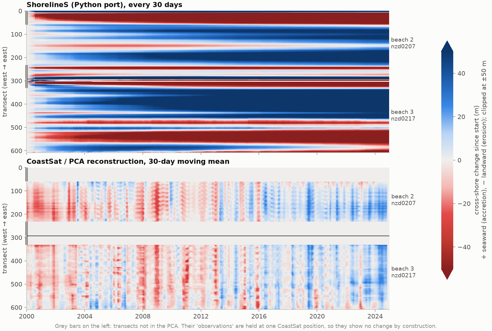
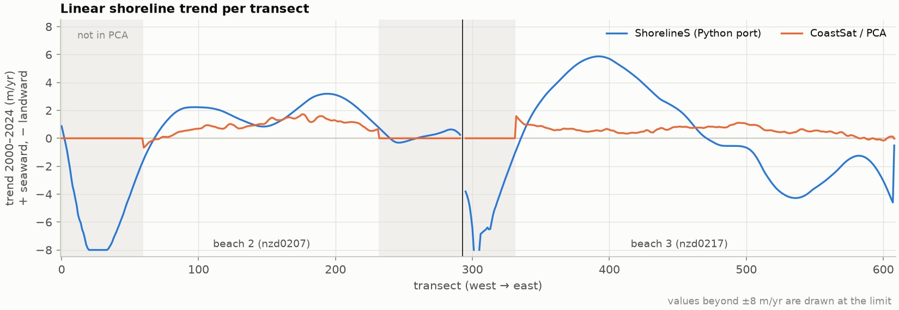
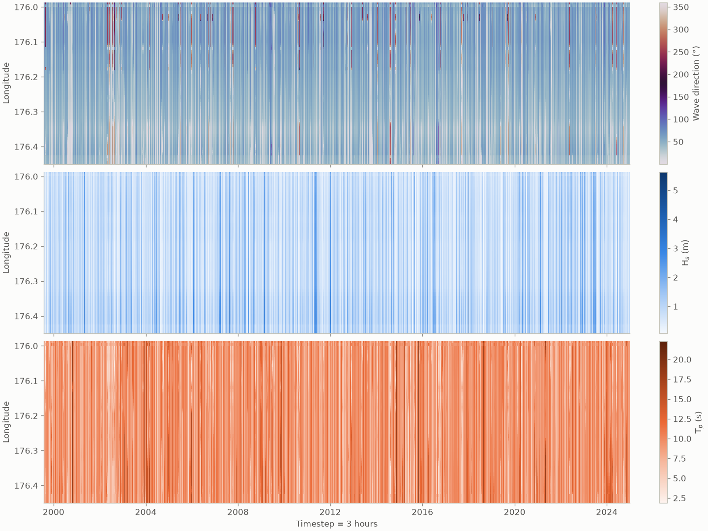
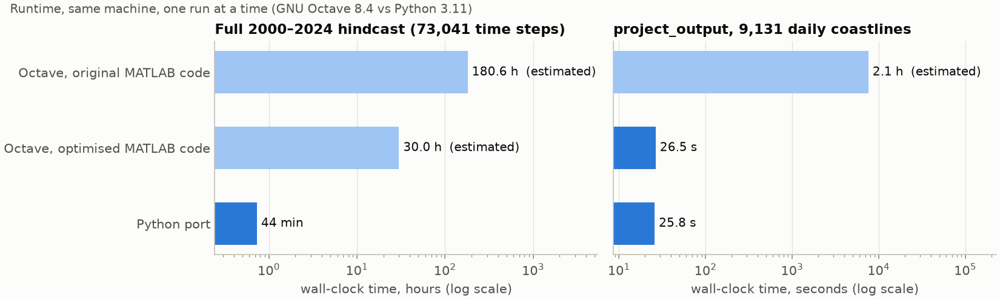
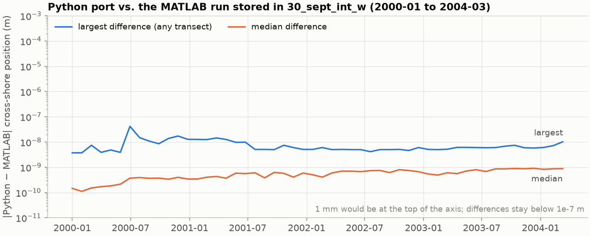

# sediment_beach

MATLAB workflow for hindcasting shoreline change on a New Zealand embayment
("site 2", Bay of Plenty) with the [ShorelineS](https://github.com/Deltares/ShorelineS)
one-line shoreline model, and comparing the model against CoastSat satellite
shorelines.

The workflow:

1. interpolates an Oceanum wave hindcast onto the 25 m depth contour
   (`create_nc.m`), or makes synthetic wave directions with the same wave
   heights and periods (`sinth_waves.m`);
2. rebuilds the observed CoastSat shoreline of the selected beaches from a PCA
   reconstruction without mode 1 (`eofs_code2.m`) and uses it as the model's
   initial coastline (`initial_grid.m`);
3. runs ShorelineS at a 3-hour time step (`hindcast_run.m`; currently
   1999-08-01 to 2004-06-30 with the synthetic waves and closed boundaries);
4. projects modelled and observed shorelines onto the initial coastline and
   plots both as cross-shore change (`project_output.m`).

Several parameter sets can be run in parallel with `python/run_ensemble.py`
(or `run_ensemble.m` with MATLAB's `parfor`); see
[Running several parameter sets in parallel](#running-several-parameter-sets-in-parallel).

---

## Requirements

| Requirement | Used for |
|---|---|
| MATLAB R2016b or newer (implicit expansion) | everything |
| Mapping Toolbox (`projcrs`, `projfwd`) | `initial_grid.m`, `create_nc.m` |
| `readtable` (base MATLAB) | `initial_grid.m` |
| `VideoWriter` (base MATLAB) | animation when `S.video=1` |
| [Git LFS](https://git-lfs.com) | the `.mat` and `.nc` data files |

The `.mat` and `.nc` files are stored with Git LFS. After cloning, run
`git lfs pull`. Otherwise these files are small text pointer files and
loading them fails.

The ShorelineS model core (`ShorelineS_functions/ShorelineS.m` and the time
loop) also runs in GNU Octave 8 with the `netcdf` package. The benchmarks
below were made that way. The project scripts need MATLAB, because Octave has
no `readtable`, `projcrs`/`projfwd` or `scatteredInterpolant`.

---

## Quick start

(For the Python version, see [python/README.md](python/README.md).)

```matlab
% from the repository root, in MATLAB
git lfs pull                  % (in a shell) fetch the data files once
create_nc                     % optional: rebuilds input_25_contour.nc + wave_data.mat
hindcast_run                  % runs the model and calls project_output at the end
plot_waves                    % optional: plots the wave time series along the contour
```

`hindcast_run.m` adds `ShorelineS_functions/` to the path relative to its own
location, so it can be run from any working directory.

---

## Repository contents

### Scripts and functions (project code)

| File | Type | What it does |
|---|---|---|
| `hindcast_run.m` | script | **Main entry point.** Sets all ShorelineS parameters in a struct `S`, builds the initial coastline with `initial_grid`, runs `ShorelineS(S)` and then `project_output`. |
| `initial_grid.m` | function | `[x, y, x_initial, y_initial, g] = initial_grid(beach, dy, n_d)`. For each selected beach it reads the transects from the CoastSat workbook (`nzdXXXX.xlsx`, sheet *Transects*), converts transect origins to NZTM2000 (EPSG:2193), and rebuilds shoreline positions as `origin + (PC_lst + mean_PC_lst) * [sin(phi), cos(phi)]` from the PCA reconstruction without mode 1 (`PC_lst_site2.mat`, `mean_PC_lst_site2.mat`). Transects left out of the PCA (`remove{b}`) are held fixed at their first valid CoastSat observation (sheet *Intersect points*). Beaches are joined with one NaN column between them. Returns the full daily time series (`x`, `y`: time x transects, row 1 = 1999-08-01) and row `dy+1` (the start date) as the initial coastline. |
| `project_output.m` | function | `project_output(x, y, file_out, dy, interv, x_initial, y_initial, n_d [, wave_mat])`. Loads `<file_out>/output.mat`, selects the observations of the simulated period (rows `dy+1 : dy+n_d+1`), and uses `get_polydistance` (normals of ±500 m around the initial coastline) to compute cross-shore change for the model, for the observations every `interv` days, and for the daily observations. Plots model, CoastSat and its 30-day moving mean; observed and modelled shorelines once a year; and, from `wave_mat` (default `wave_data.mat`; `waves_sinth.mat` for the synthetic waves), the alongshore wave-energy flux and the wave-direction anomalies next to the cross-shore change. The wave figures are skipped with a warning if `wave_mat` cannot be read. |
| `run_ensemble.m` | function | `run_ensemble(params, S0, out_root)`: runs ShorelineS for each element of the struct array `params` (fields override `S0`) in a `parfor` loop, one folder per run, plus `summary.csv`. |
| `create_nc.m` | script | Preprocesses the Oceanum hindcast `oceanum_paper2.nc` (48 nodes, hourly from 1979). Selects 1999-08-01 to 2024-12-30, finds the 25 m depth contour, interpolates Hs, Tp and mean direction (direction through its sin/cos components) linearly onto the contour points, with nearest-neighbour extrapolation, and writes `input_25_contour.nc` in the ShorelineS wave-station format (`time` in seconds since 1999-08-01, `station_x/y` in NZTM, `point_hm0`, `point_tp`, `point_wavdir`). Also saves `wave_data.mat`. Note that `nccreate` fails if `input_25_contour.nc` already exists, so delete it first. |
| `sinth_waves.m` | script | Like `create_nc.m`, but replaces the wave directions with synthetic ones: uniformly random 0–45° or 225–360° in odd years and 45–225° in even years (`rng(1)`). Hs and Tp are the interpolated hindcast. Writes `sinthe_waves.nc` and `waves_sinth.mat`. Fails if `sinthe_waves.nc` exists. |
| `eofs_code2.m` | script | PCA (SVD) of the CoastSat series of the 16 beaches; reconstructs them without mode 1 (`PC_lst`), the per-transect mean (`mean_PC_lst`) and the variance fraction outside mode 1 (`explained_rem`). Needs `load_data`, `tr_selection`, `smoothgap2` and `shoreline_metrics` from the paper 1 code, which is **not in this repository** (the `addpath` points to a local Windows folder), so it cannot be rerun from here. Its outputs are committed. |
| `plot_waves.m` | function | Plots direction, Hs and Tp along the contour against time, from `wave_data.mat`. |
| `load_data2.m` | function | Earlier, **unfinished** loader for the CoastSat workbooks. It is not called anywhere and does not run as is (it uses an undefined `input_file` and the loop is not closed). |
| `cmocean.m` | function | Third-party perceptually uniform colormaps (Thyng et al., 2016). |

### Data

| File | Content |
|---|---|
| `nzd0204.xlsx` … `nzd0332.xlsx` | CoastSat exports, one per beach. Sheets: *Transects* (one row per transect: `orientation` in column 3, `land_x`/`land_y` = lon/lat of the landward end in columns 18-19), *Intersect points* (one row per image date, one `"lat,lon"` text cell per transect), *Intersects* (cross-shore distance per transect and date), *Tides*. Site 2 uses 16 workbooks, listed west to east in `initial_grid.m`. |
| `PC_lst_site2.mat` | `PC_lst{1..16}`: PCA reconstruction without mode 1 (`eofs_code2.m`), daily cross-shore position per beach (9284 days from 1999-08-01 x retained transects). Used by `initial_grid`. |
| `mean_PC_lst_site2.mat` | `mean_PC_lst{1..16}`: time mean of `PC_lst` per transect (repeated over time), added to `PC_lst`. |
| `explained_rem_site2.mat` | `explained_rem{1..16}`: fraction of the variance not in mode 1 (shown in `project_output`'s figures). |
| `A_site2.mat`, `mint_site2.mat` | The earlier PCA reconstruction (all modes) and its offsets, used by `initial_grid` before the switch to `PC_lst`; the [Findings](#findings) below were made with these. |
| `Astd_site2.mat` | `Astd.beach1..16`: standard deviation of the reconstruction (not used by the scripts). |
| `unique_days.mat` | Helper date lists (not used by the scripts). |
| `oceanum_paper2.nc` | Raw Oceanum wave hindcast at 48 nodes: `hs`, `tps`, `dpm`, `botl` (depth), `latitude`, `longitude`, `time` (hours since 1979-02-01). |
| `input_25_contour.nc` | Model wave input made by `create_nc.m`: 94 stations along the 25 m contour, 74,265 3-hourly records from 1999-08-01. (`create_nc.m` now writes `input_25_contour_opt.nc`.) |
| `wave_data.mat` | The same interpolated waves as MATLAB arrays (v7.3). |
| `sinthe_waves.nc`, `waves_sinth.mat` | Synthetic-direction waves from `sinth_waves.m` (same stations, times, Hs and Tp as `input_25_contour.nc`). |
| `2_oct_opt/output.mat` | Stored result of a later `hindcast_run`. |
| `30_sept_int_w/output.mat` | Stored result of an earlier `hindcast_run` (`O`, `P`, `S`). The benchmark harness takes its initial coastline from here. |

### Results, figures, Python port, benchmarks

| Folder | Content |
|---|---|
| [`results/`](results/README.md) | Output of the full 2000–2024 hindcast (Python port): `output.mat`, `project_output` results, per-transect trends, all benchmark timings (`.mat` files in Git LFS) |
| `docs/figures/` | Figures used in this README (`python/make_figures.py`) |
| [`python/`](python/README.md) | Python port of the workflow and of the ShorelineS code path used here, including closed (cyclic) sections such as islands, with tests against Octave |
| `benchmark/` | MATLAB/Octave timing harness and equivalence tests |

### `ShorelineS_functions/`

A vendored copy of the ShorelineS model (IHE Delft & Deltares, LGPL-2.1).
`ShorelineS(S)` takes the parameter struct `S`, fills in the defaults
(`initialize_defaultvalues.m` documents every parameter), and runs the time
loop. Each step goes through four phases:

1. **Grid**: regrid the coastline (`make_sgrid_mc`), with groynes and structures.
2. **Transport**, per coastline section: interpolate waves to the coast
   (`introduce_wave` → `get_interpolation_on_grid`), refract and shoal them
   (`wave_refraction`, `wave_breakingheight`), find the critical high-angle
   transport angle (`wave_angles` → `get_Sphimax`), compute bulk longshore
   transport (`transport`, KAMP formula here), and handle shadowing
   (`transport_shadow_treat` → `find_shadows_mc`) and boundary conditions.
3. **Coastline change** (`coastline_change`), plus overwash
   (`find_overwash_mc`), merging of sections, and NaN cleanup.
4. **Output**: store to `output.mat` every `S.storageinterval` days
   (`save_shorelines`), and plot every `S.plotinterval` steps (`plot_coast`).

The run settings used in this project (see `hindcast_run.m`):

| Parameter | Value | Meaning |
|---|---|---|
| `reftime` / `endofsimulation` | 1999-08-01 / 2004-06-30 | simulation period (the Findings below: 2000-01-01 / 2024-12-30) |
| `dt`, `tc` | 1/(365·8) yr, 0 | fixed 3-hour time step (≈ 14,000 steps; 73,000 for 2000–2024) |
| `wvcfile` | `sinthe_waves.nc` | wave time series at 94 contour stations (Findings: `input_25_contour.nc`) |
| `interpolationmethod` | `alongshoremapping` | how stations map onto the coastline |
| `ddeep`, `dnearshore` | 25 m, 25 m | depth of the wave input and of the nearshore point |
| `ds0` | 75 m | alongshore grid size |
| `trform` | `KAMP` | Kamphuis transport formula |
| `d` | 10 m | active profile height |
| boundary conditions | `closed` | at both ends (Findings: `periodic`) |
| `d50`, `gamma` | defaults 2·10⁻⁴ m, 0.72 | `python/hindcast_run.py` sets 10⁻⁴ m and 0.5 |
| `storageinterval` | 30 days | output interval |
| `plotinterval` | 240 steps (30 days) | plot/video interval |

## Findings

Results of the full 2000–2024 hindcast with the settings of `hindcast_run.m`,
run with the Python port. The Python run reproduces the MATLAB run stored in
`30_sept_int_w` to 1e-7 m (see [Performance](#performance)), so these are the
results of the MATLAB model as configured. The outputs are in
[`results/`](results/README.md), and the figures are made by
`python/make_figures.py`.





Cross-shore change is measured along ±500 m normals from the initial coastline
(`project_output`). Positive means seaward (accretion). "Not in the PCA" marks
the transects whose observations are held at a single CoastSat position.

- **The model is not calibrated.** The settings are ShorelineS defaults
  (`qscal = 1`, `d = 10 m`, Kamphuis transport), and modelled change is
  several times larger than observed. On the transects with real
  observations (in the PCA), the median change by 2024 is +47 m in the model
  vs +13 m in CoastSat on beach 2. The 5–95 % range on beach 3 is −122 to
  +149 m in the model vs +3 to +18 m in CoastSat. The model's cross-shore
  variability (median standard deviation 17 m) is about twice the observed
  (9 m).
- **Beach 2 (nzd0207): the alongshore pattern is reasonable.** The per-transect
  trends of model and CoastSat correlate (r = 0.65 on PCA transects, both
  accreting in the middle of the beach), but the model's median trend is
  about twice the observed (+1.9 vs +0.9 m/yr).
- **Beach 3 (nzd0217): the pattern does not match** (r = 0.19). CoastSat shows
  a uniform small accretion (+0.6 m/yr). The model has a large accreting bulge
  around transects 330–450 (up to +6 m/yr) and erosion in the eastern third
  (down to −4 m/yr).
- **The west end of each beach erodes strongly in the model:** −260 to −390 m
  by 2024, of which −100 to −145 m happens in the first ~2.5 years. These
  stretches (beach 2 transects 1–60, beach 3 transects 1–38) are exactly the
  ones left out of the PCA, so the observations cannot confirm or refute this.
  The erosion is part of the reshaping of the whole beach described below:
  sand moves from the west ends to the middle of each beach.
- **The model does not follow CoastSat's ups and downs over time.** CoastSat
  shows beach-wide erosion and accretion (for example erosion around 2009 and
  2011, and accretion in 2019–2020 and 2023–2024) and a clear seasonal cycle.
  The model shows none of this. The next section explains why.

### Why ShorelineS does not reproduce the CoastSat pattern

The two panels of the cross-shore change figure show different kinds of
change. CoastSat/PCA is dominated by the whole beach moving seaward and
landward together. The model, as set up here, can only move sand along each
beach, so it shows a slow reshaping of the coastline instead. The numbers
below are for the transects with real observations (in the PCA), from
`python/compare_model_coastsat.py`.

1. **The observed change is mostly the whole beach moving together.** The
   beach-average position explains 82 % (beach 2) and 76 % (beach 3) of the
   CoastSat/PCA variance over time: the vertical stripes in the lower panel.
2. **The model cannot move a whole beach seaward or landward.** In ShorelineS
   the coastline changes only through gradients in longshore transport
   (−dQs/ds per unit profile height). With `periodic` boundaries the
   transport leaving one end of a beach re-enters at the other end, and no
   source or sink of sand is active here: no cross-shore exchange, sea-level
   rise, nourishments or rivers. Each beach therefore keeps its sand volume.
   The model's beach-average position (all transects) varies by only 0.25 m
   (beach 2) and 1.0 m (beach 3) over 25 years, against a standard deviation
   of 9.7 and 8.4 m in CoastSat. The model can only redistribute sand along
   each beach.
3. **What the model does show is a slow reshaping of the coastline.** The
   horizontal bands in the upper panel arise because the initial 1999
   coastline is not in equilibrium with the modelled wave climate. The model
   gradually turns the coastline towards it: the west ends feed the middle of
   each beach, and the trend continues for the whole 25 years. With
   uncalibrated transport (`qscal = 1`) this reaches tens to hundreds of
   metres. Shorter-term variability (detrended, time scales under ~2 years)
   is tiny by comparison: 0.2–0.5 m in the model against 7.2–7.3 m in
   CoastSat. The correlation with CoastSat is 0.07–0.08 per transect and
   0.11–0.18 for the beach average.
4. **Most of the observed beach-wide signal is a seasonal cycle of unknown
   cause.**
   - **The cycle.** Both beaches are 5–7 m wider than average in May–July
     and 4–8 m narrower in December–January (12–15 m peak to peak). The
     cycle is also in the raw CoastSat positions (`Intersects` sheet), so
     the PCA does not create it.
   - **Not the average wave conditions.** At the 25 m contour the monthly
     mean waves hardly change through the year: Hs 0.75–0.97 m, Tp
     8.6–9.9 s, direction 42–50°.
   - **Not tide sampling.** The tide at image time is itself seasonal
     (+0.13 to +0.21 m in January–April, −0.04 to −0.10 m in June–July). But
     the positions are already tide-corrected: they correlate weakly
     *positively* with the tide (+0.15 to +0.22), where an uncorrected
     waterline would correlate negatively. Removing the tide-related part
     leaves the cycle unchanged.
   - **Opposite to the storm season.** Waves above 2 m occur 13–16 % of the
     time in June–July and 3–4 % in November–December, so the beaches are
     widest when storms are most frequent. That is the reverse of the usual
     storm-erosion-and-recovery cycle.

   The cycle is therefore not driven by anything in the wave input. Possible
   causes, which the data in this repository cannot separate:
   - seasonal mean sea level (CoastSat's tide correction covers only the
     astronomical tide);
   - winds and wind-blown sand;
   - satellite or processing effects (sun angle, wet sand).

**What it would take for model and observations to be comparable:**

- **Seasonal and event-scale change.** The model needs a cross-shore
  process: a sediment source or sink, or an equilibrium shoreline model
  coupled to the longshore transport. Even then, the seasonal cycle needs
  forcing beyond the current wave file, and its cause should be established
  first.
- **The long-term pattern.** Calibrate the transport (`qscal`) and the active
  profile height (`d`), and reconsider the `periodic` boundaries. The beaches
  are separate embayments, so closed ends, or ends with a prescribed
  transport, are probably more realistic.
- **Spin-up.** Start from a coastline closer to equilibrium with the wave
  climate, or discard the first years, so that the comparison is not
  dominated by the initial reshaping.

Wave forcing along the 25 m contour, 1999–2024 (`plot_waves`):



---

## Running several parameter sets in parallel

One model run uses one CPU: the time loop is sequential, and the arrays of a
time step are too small to gain from multithreading. To use several CPUs, run
several parameter sets at once:

```bash
cd python
python run_ensemble.py --set qscal=0.5,1,2 --set wave_file=../sinthe_waves.nc,../input_25_contour.nc \
                       --end 2004-06-30 -j 4 --out-dir output/qscal_waves
```

Each run gets its own folder, and `summary.csv` collects the parameters, run
times and model-vs-CoastSat statistics. Parameter sets can also come from a
CSV or JSON file (`--runs`). See
[python/README.md](python/README.md#running-several-parameter-sets-in-parallel).
`run_ensemble.m` is the MATLAB equivalent (`parfor`, Parallel Computing
Toolbox).

## Performance

### How it was measured

There is no MATLAB in the environment used for this work, so all timings come
from **GNU Octave 8.4** (headless, under Xvfb) on a 4-core cloud container.
The harness is `benchmark/bench_run.m`. It runs the exact `hindcast_run.m`
model configuration (same coastline, wave file, grid and physics) for a short
period from 2000-01-01, using the initial coastline stored in
`30_sept_int_w/output.mat`. Absolute times in MATLAB will be lower, because
its JIT runs scalar loops much faster than Octave does, but the hotspots are
the same.

Per-step cost is the difference between a 6-day and a 2-day run (32 steps),
so start-up work (reading the 168 MB NetCDF, first plot) cancels out.

| Run (Octave 8.4, model only, no per-step plotting) | Original | Optimised | Speed-up |
|---|---:|---:|---:|
| 2 simulated days (17 steps), total | 171.0 s | 52.4 s | 3.3× |
| 6 simulated days (49 steps), total | 455.3 s | 104.3 s | 4.4× |
| 30 simulated days (241 steps), total | – | 369.8 s | |
| **Marginal cost per 3-hour time step** | **8.9 s** | **1.4–1.6 s** | **≈ 6×** |
| Extrapolated full 2000–2024 hindcast (73,040 steps) | ≈ 180 h (7.5 days) | ≈ 30 h | ≈ 6× |

Each run was timed alone on the machine. A run uses one core: runtime does
not change with the number of CPUs, because every time step depends on the
previous one and the arrays per step (~600 coastline points) are too small
for multithreading. More cores only help to run several simulations at once.
For the [Python port](python/README.md), see the end of this section.

Plotting adds to that. With the original `hindcast_run.m` setting (plot and
grab a video frame every step), each plotted step cost a further **≈ 8.9 s**
in Octave (2-day run: 306.6 s with plotting vs 164.7 s without). Over a full
run that is about 180 more hours, plus a 73,000-frame video kept in memory.
With `S.plotinterval = 240`, plotting happens about 300 times per run.

| Component (Octave) | Original | Optimised | Speed-up |
|---|---:|---:|---:|
| `get_polydistance`, 609 normals vs. 650-point coastline | 0.78 s/call | 0.006 s/call | 131× |
| ↳ `project_output.m`, full 9,131-day CoastSat series | ≈ 2.1 h (estimated) | 26.5 s (measured) | ≈ 280× |
| `wave_breakingheight`, 5,000 points | 2.93 s | 0.021 s | ≈ 140× |
| `get_intersections`, coastline vs. short line (300 calls) | 0.37 s | 0.11 s | 3.3× |

The 6-day runs with the original and optimised code give **identical
output**: all 57 fields of `O` in `output.mat` are bit-for-bit equal.

### Where the time went (original code)

Profile of the original code over 9 time steps (≈ 112 s in Octave):

| Function | Inclusive time | Why |
|---|---|---|
| `wave_breakingheight` (direct + via `get_Sphimax`) | 35 s | per-point scalar loop with an iterative solve: 240,000 scalar calls to `wave_shoalref`/`get_disper` in 9 steps |
| `plot_coast` | 31 s | full figure redraw (here only one frame; the original setting redraws every step) |
| `introduce_wave` | 19 s | for each of 94 stations, every step: `unique()` over the 74,265-entry time series, `sind`/`cosd` of the whole series, 4 × `interp1` over the whole series |
| `get_intersections` (via `find_shadows_mc`, `find_overwash_mc`) | 19 s | about 26 `repmat` calls per call building every segment-pair matrix, then a scalar loop |

### What was changed

All changes keep the model's behaviour. The equivalence tests in `benchmark/`
compare each function against the original. A 2-day model run gives
**identical coastline positions** (`O.x`, `O.y` and all geometry fields are
bit-for-bit equal). Transport differs only at floating-point round-off level
(`O.QS` max |Δ| = 3·10⁻¹⁰ m³/yr on values of order 10⁶).

| File | Change | Result |
|---|---|---|
| `ShorelineS_functions/wave_breakingheight.m` | The per-point secant iteration is vectorised over all points: points that have converged are masked out, and a vectorised `wave_shoalref_vec` does exactly the same branching as `wave_shoalref`. | ~140× faster for 5,000 points. Results equal to ≤ 4·10⁻¹⁵ (round-off). |
| `ShorelineS_functions/get_intersections.m` | Implicit expansion replaces the ~26 full-size `repmat` copies. Only segments whose bounding box can reach the other polyline are evaluated (NaN-adjacent segments are always kept, so even the original's edge cases stay the same). The `ui`/`uj` loop is vectorised. | Same crossings, indices and coordinates on 3,000 random cases. The fractions `ui`/`uj` occasionally differ by 1 ulp (≤ 9·10⁻¹⁶). ~3× faster for the model's typical coastline-vs-short-line calls. |
| `ShorelineS_functions/introduce_wave.m` | `length(unique(t))>1` becomes `any(t~=t(1))`. Each station is interpolated on the 2 time points around `tnow` (the result is the same for a strictly increasing time axis; otherwise it falls back to the full series). All stations are then interpolated in one `interp1` call per parameter. | Bit-identical output. |
| `ShorelineS_functions/get_polydistance.m` | All normals are intersected with the coastline at once. Only (normal, segment) pairs whose bounding boxes overlap are evaluated, with the same crossing arithmetic. | Bit-identical on the stored model output. ≤ 10⁻¹³ m on random polylines. **131× faster.** This speeds up `project_output.m` (≈ 9,700 calls over the daily CoastSat series) and `save_shorelines`. |
| `ShorelineS_functions/get_Sphimax.m` | The warning state is saved and restored around the 3×3 solves, instead of `warning off`/`warning on` inside the per-point loop. The blanket `warning on` switched on every warning for the rest of the run (in Octave that printed ~500,000 broadcasting notices per 6 simulated days). | Same results; no warning flood. |
| `ShorelineS_functions/make_video.m` | Drops empty frames before `writeVideo`. With `plotinterval>1`, frames are stored at `V(it+1)`, which leaves gaps, and the `try` around `writeVideo` used to swallow the error, so no video was written. | Video works with `plotinterval>1`. |
| `hindcast_run.m` | `S.plotinterval = 240` (one frame per 30 days instead of per 3-hour step). The hard-coded `C:\Users\...` `addpath` becomes a path relative to the script. | Avoids ~73,000 figure redraws, and a video frame array that would need hundreds of GB of memory for the full 25-year run. **This changes the animation**: one frame per 30 days. Set `S.plotinterval=1` for the original behaviour. |
| `create_nc.m` | Interpolation is linear in the node values, so a 94 × 48 weight matrix is built once and each field becomes one matrix product, instead of a `scatteredInterpolant` evaluation for every hour (3 × ~74,000 evaluations) into arrays that grew inside the loop. Hours with missing node values fall back to the original per-hour interpolation. | Same values (≤ 10⁻¹⁵, checked with an equivalent SciPy implementation). Removes the ~220,000 interpolant evaluations and the quadratic array growth. |
| `initial_grid.m` | Only the *Intersect points* columns that are actually used (the transects removed from the PCA) are parsed cell by cell and projected, instead of every cell in the sheet. | For beaches `[2 3]`, parses 159 of 609 columns (26 %). Same output. |
| `project_output.m` | One vectorised `movmean(..., 2, 'omitnan')` replaces the per-transect loop. | Same output. |

### Python port vs. Octave



`python/` contains a Python port of the workflow (see
[python/README.md](python/README.md)). Same machine, each run alone:

| | Octave, original | Octave, optimised | Python |
|---|---:|---:|---:|
| Model, 2 days (17 steps), total | 171.0 s | 52.4 s | 0.9 s |
| Model, 6 days (49 steps), total | 455.3 s | 104.3 s | 2.1 s |
| Model, 30 days (241 steps), total | – | 369.8 s | 9.0 s |
| **Model, cost per time step** | **8.9 s** | **1.4–1.6 s** | **0.035 s** |
| `project_output`, full 9,131-day series | ≈ 2.1 h (est.) | 26.5 s | 25.8 s |
| `initial_grid` (beaches 2, 3) | – ¹ | – ¹ | 4.8 s |
| `create_nc` | – ¹ | – ¹ | 6 s |

¹ Needs `readtable`, `projcrs`/`projfwd` or `scatteredInterpolant`, which
Octave does not have.

**Full hindcast in Python:** the complete 2000-01-01 to 2024-12-30 run
(73,041 time steps) took **43.9 minutes** (36 ms per step), against an
estimated ≈ 30 hours in Octave with the optimised code.

**Python vs. the real MATLAB run.** `30_sept_int_w/output.mat` holds a run of
this configuration made in MATLAB (output up to 2004-03-10). The Python run
uses the same grid at every stored time, and the coastline positions differ
by at most 1·10⁻⁷ m (median 9·10⁻¹⁰ m on cross-shore distance) after 4 years.
That is floating-point round-off, and it does not grow over time.



**Why Python is faster for the model but not for `project_output`.** The
MATLAB model code makes hundreds of thousands of small function calls per
simulated day (`sind`, `interp1`, `unique`, and per-coastline-point calls of
`get_intersections` in `find_shadows_mc` and `find_overwash_mc`). Octave has
no JIT compiler, so each call costs 10–100 µs of interpreter overhead, which
dominates the run time. The Python port does the same arithmetic in batched
NumPy operations: for example, all shadow rays of a coastline section are
tested in one call (276 ms per call in Octave, 3 ms in Python). In
`project_output` both versions are vectorised and spend their time in
compiled array code, so they run at the same speed. MATLAB's JIT makes
function calls and loops much cheaper than Octave's interpreter, so the gap to
MATLAB will be smaller than the gap to Octave (MATLAB was not available to
measure it).

### Reproducing

```matlab
% baseline = the commit before the optimisation
% (shell)  git worktree add ../baseline aa45896
cd benchmark
bench_run('../baseline/ShorelineS_functions', 2, 0, 'out_orig');   % original
bench_run('../ShorelineS_functions',          2, 0, 'out_new');    % optimised
compare_outputs('out_orig/output.mat', 'out_new/output.mat')
test_wave_breakingheight('../baseline/ShorelineS_functions')
test_get_intersections('../baseline/ShorelineS_functions')
test_get_polydistance('../baseline/ShorelineS_functions')
```

In Octave: `pkg load netcdf`, and run headless with
`xvfb-run octave-cli --eval "..."` (the model always draws the first frame).

---

## Notes and possible issues

Fixed (October 2026):

- **Observation window.** Row 1 of `x`/`y` from `initial_grid` is 1999-08-01,
  so the start date is row `dy+1`. `project_output` used rows `dy : dy+n_d`
  (one day early), which fails for a run starting on 1999-08-01 (`dy = 0`).
  Both versions now use rows `dy+1 : dy+n_d+1`.
- **Initial coastline date.** `initial_grid` returned the first row
  (1999-08-01) as the initial coastline whatever the start date. It now returns
  row `dy+1`. For the current start date (1999-08-01) nothing changes.
- **`project_output.m`** had been turned into a script (signature commented
  out) that loaded a hard-coded `C:\Users\...\output.mat`, used `ll`, `w`, `h`
  and `t` before defining them, assumed monthly output dates and hid the wrong
  beach-3 transects (`293+remove{3}`; beach 3 starts at column 295). It is a
  function again, with the original arguments.
- **`hindcast_run.m`**: the `addpath` is relative again, and the dates use
  `datenum` so the script also runs in GNU Octave.
- **`python/hindcast_run.py`** had a syntax error (`gamma = 0.5;` inside
  `dict(...)`), and `python/initial_grid.py` still read `A_site2.mat`.
- **Python port: crossing sections.** With the synthetic waves
  (`sinthe_waves.nc`), beaches 2 and 3 grow into each other after about
  1.5 years. The Python port then stopped with `NotImplementedError: merging
  of crossing coastline sections`: that part of ShorelineS'
  `merge_coastlines_mc` had not been ported. It is ported now
  (`python/shorelines/merge.py`) and checked against Octave.

Still open:

- **MATLAB and Python settings differ.** `python/hindcast_run.py` sets
  `d50 = 1e-4` and `gamma = 0.5` and uses `input_25_contour.nc`;
  `hindcast_run.m` uses the defaults (`d50 = 2e-4`, `gamma = 0.72`) and
  `sinthe_waves.nc`.
- `eofs_code2.m` depends on functions that are not in the repository (see above).
- GNU Octave's `movmean` ignores `'omitnan'` (it warns and includes NaN); MATLAB
  is fine.
- **Stored run.** `30_sept_int_w/output.mat` only has output up to 2004-03
  (52 storage times), so that run probably did not finish the full period.
- `make_video.m` writes `[S.outputdir,'\animation']` with a Windows path
  separator.
- **First CoastSat image skipped.** `initial_grid.m` reads `Range B2:KH517`
  with `readtable`, which uses the first row of the range (row 2, the image
  of 1999-09-29) as variable names. The transects that are not in the PCA are
  therefore held at the position of the *second* image. (The Python port
  confirmed this: it reproduces the stored initial coastline only with this
  behaviour.)
- `create_nc.m` fails if `input_25_contour.nc` already exists (`nccreate`
  does not overwrite).
- The ShorelineS default `S.plotinterval = 1` combined with `S.video = 1`
  keeps a full-resolution frame in memory for every time step. Keep the
  interval coarse for long runs.
